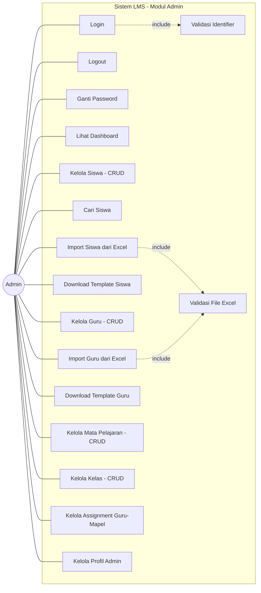
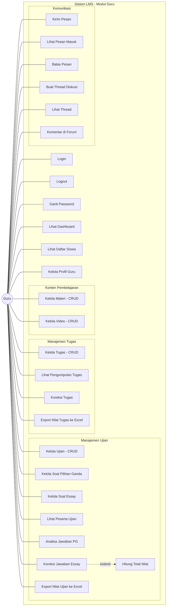
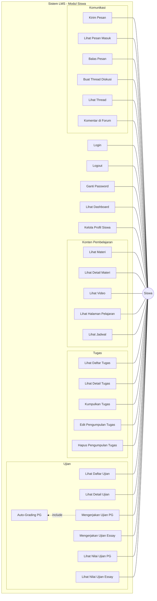
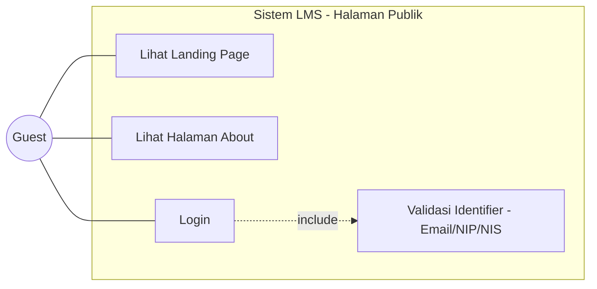

# Learning Management System - SMP Jekulo Kudus

Sistem Manajemen Pembelajaran (LMS) berbasis web untuk SMP Jekulo, Kudus, Jawa Tengah. Dibangun menggunakan Laravel 11, Bootstrap 5, dan MySQL.

## Tech Stack

| Komponen | Teknologi |
|---|---|
| Framework | Laravel 11.9 |
| PHP | 8.2+ |
| Database | MySQL / MariaDB |
| Frontend | Bootstrap 5.2.3 + Vite 5.0 |
| Auth | Laravel UI |
| Excel | Maatwebsite/Excel 3.1 |

---

## Use Case Diagram

### Diagram Utama - Seluruh Aktor

```mermaid
flowchart TB
    subgraph Sistem LMS
        direction TB

        subgraph UC_AUTH["Autentikasi"]
            UC_LOGIN["Login"]
            UC_LOGOUT["Logout"]
            UC_GANTI_PASS["Ganti Password"]
        end

        subgraph UC_ADMIN["Modul Admin"]
            UC_ADMIN_DASH["Lihat Dashboard"]
            UC_KELOLA_SISWA["Kelola Siswa CRUD"]
            UC_CARI_SISWA["Cari Siswa"]
            UC_IMPORT_SISWA["Import Siswa Excel"]
            UC_DL_TPL_SISWA["Download Template Siswa"]
            UC_KELOLA_GURU["Kelola Guru CRUD"]
            UC_IMPORT_GURU["Import Guru Excel"]
            UC_DL_TPL_GURU["Download Template Guru"]
            UC_KELOLA_MAPEL["Kelola Mata Pelajaran"]
            UC_KELOLA_KELAS["Kelola Kelas"]
            UC_ASSIGN_GURU["Kelola Assignment Guru-Mapel"]
            UC_PROFIL_ADMIN["Kelola Profil Admin"]
        end

        subgraph UC_GURU["Modul Guru"]
            UC_GURU_DASH["Lihat Dashboard"]
            UC_DAFTAR_SISWA["Lihat Daftar Siswa"]
            UC_KELOLA_UJIAN["Kelola Ujian CRUD"]
            UC_KELOLA_PG["Kelola Soal PG"]
            UC_KELOLA_ESSAY["Kelola Soal Essay"]
            UC_DAFTAR_SISWA_UJIAN["Lihat Peserta Ujian"]
            UC_ANALISA_PG["Analisa Jawaban PG"]
            UC_KOREKSI_ESSAY["Koreksi Jawaban Essay"]
            UC_EXPORT_NILAI_UJIAN["Export Nilai Ujian"]
            UC_KELOLA_TUGAS["Kelola Tugas CRUD"]
            UC_LIHAT_KUMPUL["Lihat Pengumpulan Tugas"]
            UC_KOREKSI_TUGAS["Koreksi Tugas"]
            UC_EXPORT_NILAI_TUGAS["Export Nilai Tugas"]
            UC_KELOLA_MATERI["Kelola Materi CRUD"]
            UC_KELOLA_VIDEO["Kelola Video CRUD"]
            UC_KIRIM_PESAN_G["Kirim Pesan"]
            UC_LIHAT_PESAN_G["Lihat Pesan Masuk"]
            UC_BALAS_PESAN_G["Balas Pesan"]
            UC_PROFIL_GURU["Kelola Profil Guru"]
        end

        subgraph UC_SISWA["Modul Siswa"]
            UC_SISWA_DASH["Lihat Dashboard"]
            UC_LIHAT_MATERI["Lihat Materi"]
            UC_DETAIL_MATERI["Lihat Detail Materi"]
            UC_LIHAT_UJIAN["Lihat Daftar Ujian"]
            UC_DETAIL_UJIAN["Lihat Detail Ujian"]
            UC_KERJAKAN_PG["Mengerjakan Ujian PG"]
            UC_KERJAKAN_ESSAY["Mengerjakan Ujian Essay"]
            UC_NILAI_PG["Lihat Nilai Ujian PG"]
            UC_NILAI_ESSAY["Lihat Nilai Ujian Essay"]
            UC_LIHAT_TUGAS["Lihat Daftar Tugas"]
            UC_DETAIL_TUGAS["Lihat Detail Tugas"]
            UC_KUMPUL_TUGAS["Kumpulkan Tugas"]
            UC_EDIT_KUMPUL["Edit Pengumpulan"]
            UC_HAPUS_KUMPUL["Hapus Pengumpulan"]
            UC_LIHAT_VIDEO["Lihat Video"]
            UC_LIHAT_JADWAL["Lihat Jadwal"]
            UC_LIHAT_PELAJARAN["Lihat Halaman Pelajaran"]
            UC_KIRIM_PESAN_S["Kirim Pesan"]
            UC_LIHAT_PESAN_S["Lihat Pesan Masuk"]
            UC_BALAS_PESAN_S["Balas Pesan"]
            UC_PROFIL_SISWA["Kelola Profil Siswa"]
        end

        subgraph UC_FORUM["Modul Forum Diskusi"]
            UC_BUAT_THREAD["Buat Thread Diskusi"]
            UC_LIHAT_THREAD["Lihat Thread"]
            UC_KOMENTAR["Komentar di Forum"]
        end

        subgraph UC_GUEST["Modul Guest"]
            UC_LANDING["Lihat Landing Page"]
            UC_ABOUT["Lihat Halaman About"]
        end
    end

    ADMIN((Admin))
    GURU_ACTOR((Guru))
    SISWA_ACTOR((Siswa))
    GUEST((Guest))

    ADMIN --- UC_LOGIN
    ADMIN --- UC_LOGOUT
    ADMIN --- UC_GANTI_PASS
    ADMIN --- UC_ADMIN_DASH
    ADMIN --- UC_KELOLA_SISWA
    ADMIN --- UC_CARI_SISWA
    ADMIN --- UC_IMPORT_SISWA
    ADMIN --- UC_DL_TPL_SISWA
    ADMIN --- UC_KELOLA_GURU
    ADMIN --- UC_IMPORT_GURU
    ADMIN --- UC_DL_TPL_GURU
    ADMIN --- UC_KELOLA_MAPEL
    ADMIN --- UC_KELOLA_KELAS
    ADMIN --- UC_ASSIGN_GURU
    ADMIN --- UC_PROFIL_ADMIN

    GURU_ACTOR --- UC_LOGIN
    GURU_ACTOR --- UC_LOGOUT
    GURU_ACTOR --- UC_GANTI_PASS
    GURU_ACTOR --- UC_GURU_DASH
    GURU_ACTOR --- UC_DAFTAR_SISWA
    GURU_ACTOR --- UC_KELOLA_UJIAN
    GURU_ACTOR --- UC_KELOLA_PG
    GURU_ACTOR --- UC_KELOLA_ESSAY
    GURU_ACTOR --- UC_DAFTAR_SISWA_UJIAN
    GURU_ACTOR --- UC_ANALISA_PG
    GURU_ACTOR --- UC_KOREKSI_ESSAY
    GURU_ACTOR --- UC_EXPORT_NILAI_UJIAN
    GURU_ACTOR --- UC_KELOLA_TUGAS
    GURU_ACTOR --- UC_LIHAT_KUMPUL
    GURU_ACTOR --- UC_KOREKSI_TUGAS
    GURU_ACTOR --- UC_EXPORT_NILAI_TUGAS
    GURU_ACTOR --- UC_KELOLA_MATERI
    GURU_ACTOR --- UC_KELOLA_VIDEO
    GURU_ACTOR --- UC_KIRIM_PESAN_G
    GURU_ACTOR --- UC_LIHAT_PESAN_G
    GURU_ACTOR --- UC_BALAS_PESAN_G
    GURU_ACTOR --- UC_PROFIL_GURU
    GURU_ACTOR --- UC_BUAT_THREAD
    GURU_ACTOR --- UC_LIHAT_THREAD
    GURU_ACTOR --- UC_KOMENTAR

    SISWA_ACTOR --- UC_LOGIN
    SISWA_ACTOR --- UC_LOGOUT
    SISWA_ACTOR --- UC_GANTI_PASS
    SISWA_ACTOR --- UC_SISWA_DASH
    SISWA_ACTOR --- UC_LIHAT_MATERI
    SISWA_ACTOR --- UC_DETAIL_MATERI
    SISWA_ACTOR --- UC_LIHAT_UJIAN
    SISWA_ACTOR --- UC_DETAIL_UJIAN
    SISWA_ACTOR --- UC_KERJAKAN_PG
    SISWA_ACTOR --- UC_KERJAKAN_ESSAY
    SISWA_ACTOR --- UC_NILAI_PG
    SISWA_ACTOR --- UC_NILAI_ESSAY
    SISWA_ACTOR --- UC_LIHAT_TUGAS
    SISWA_ACTOR --- UC_DETAIL_TUGAS
    SISWA_ACTOR --- UC_KUMPUL_TUGAS
    SISWA_ACTOR --- UC_EDIT_KUMPUL
    SISWA_ACTOR --- UC_HAPUS_KUMPUL
    SISWA_ACTOR --- UC_LIHAT_VIDEO
    SISWA_ACTOR --- UC_LIHAT_JADWAL
    SISWA_ACTOR --- UC_LIHAT_PELAJARAN
    SISWA_ACTOR --- UC_KIRIM_PESAN_S
    SISWA_ACTOR --- UC_LIHAT_PESAN_S
    SISWA_ACTOR --- UC_BALAS_PESAN_S
    SISWA_ACTOR --- UC_PROFIL_SISWA
    SISWA_ACTOR --- UC_BUAT_THREAD
    SISWA_ACTOR --- UC_LIHAT_THREAD
    SISWA_ACTOR --- UC_KOMENTAR

    GUEST --- UC_LANDING
    GUEST --- UC_ABOUT
    GUEST --- UC_LOGIN
```

---

### Use Case Diagram - Admin

---

### Use Case Diagram - Guru

---

### Use Case Diagram - Siswa

---

### Use Case Diagram - Guest

---

## Daftar Use Case Lengkap

### Aktor: Admin (15 Use Case)

| No | Use Case | Deskripsi |
|---|---|---|
| 1 | Login | Login menggunakan email + password |
| 2 | Lihat Dashboard | Melihat total siswa, guru, dan mapel |
| 3 | Kelola Siswa (CRUD) | Tambah, edit, hapus, dan lihat data siswa |
| 4 | Cari Siswa | Mencari data siswa berdasarkan keyword |
| 5 | Import Siswa (Excel) | Bulk import data siswa dari file Excel |
| 6 | Download Template Siswa | Download template Excel untuk import siswa |
| 7 | Kelola Guru (CRUD) | Tambah, edit, hapus, dan lihat data guru |
| 8 | Import Guru (Excel) | Bulk import data guru dari file Excel |
| 9 | Download Template Guru | Download template Excel untuk import guru |
| 10 | Kelola Mata Pelajaran (CRUD) | Tambah, edit, hapus, dan lihat data mapel |
| 11 | Kelola Kelas (CRUD) | Tambah, edit, hapus, dan lihat data kelas |
| 12 | Kelola Assignment Guru-Mapel | Menetapkan guru ke mapel dan kelas tertentu |
| 13 | Kelola Profil | Lihat dan edit profil admin + upload foto |
| 14 | Ganti Password | Mengubah password admin |
| 15 | Logout | Keluar dari sistem |

### Aktor: Guru (24 Use Case)

| No | Use Case | Deskripsi |
|---|---|---|
| 1 | Login | Login menggunakan NIP/email + password |
| 2 | Lihat Dashboard | Melihat data kelas, mapel, siswa, dan materi yang diampu |
| 3 | Lihat Daftar Siswa | Melihat siswa di kelas yang diampu |
| 4 | Kelola Ujian (CRUD) | Buat, edit, hapus ujian (judul, mapel, kelas, waktu, bobot, status terbit) |
| 5 | Kelola Soal Pilihan Ganda (CRUD) | Tambah, edit, hapus soal PG (pilihan A-E + kunci jawaban) |
| 6 | Kelola Soal Essay (CRUD) | Tambah, edit, hapus soal essay |
| 7 | Lihat Daftar Siswa per Ujian | Melihat siswa yang sudah mengerjakan ujian |
| 8 | Analisa Jawaban PG | Melihat detail jawaban PG per siswa (benar/salah) |
| 9 | Koreksi Jawaban Essay | Memberi nilai per soal essay secara manual |
| 10 | Export Nilai Ujian (Excel) | Export hasil ujian ke file Excel |
| 11 | Kelola Tugas (CRUD) | Buat, edit, hapus tugas (judul, deskripsi, file, deadline) |
| 12 | Lihat Pengumpulan Tugas | Melihat file tugas yang dikumpulkan siswa |
| 13 | Koreksi Tugas | Memberi nilai dan komentar pada tugas siswa |
| 14 | Export Nilai Tugas (Excel) | Export nilai tugas ke file Excel |
| 15 | Kelola Materi (CRUD) | Upload, edit, hapus materi pembelajaran (PDF/DOCX) |
| 16 | Kelola Video (CRUD) | Upload video lokal atau link YouTube |
| 17 | Kirim Pesan | Mengirim pesan ke siswa di kelas yang diampu |
| 18 | Lihat Pesan Masuk | Melihat pesan yang diterima |
| 19 | Balas Pesan | Membalas pesan dari siswa |
| 20 | Buat Thread Diskusi | Membuat topik diskusi di forum |
| 21 | Komentar di Forum | Mengomentari thread diskusi |
| 22 | Kelola Profil | Lihat dan edit profil guru + upload foto |
| 23 | Ganti Password | Mengubah password guru |
| 24 | Logout | Keluar dari sistem |

### Aktor: Siswa (26 Use Case)

| No | Use Case | Deskripsi |
|---|---|---|
| 1 | Login | Login menggunakan NIS/email + password |
| 2 | Lihat Dashboard | Halaman utama siswa |
| 3 | Lihat Materi | Melihat daftar materi sesuai kelas |
| 4 | Lihat Detail Materi | Melihat/download file materi |
| 5 | Lihat Daftar Ujian | Melihat ujian yang tersedia untuk kelasnya |
| 6 | Lihat Detail Ujian | Melihat informasi ujian sebelum mengerjakan |
| 7 | Mengerjakan Ujian PG | Mengerjakan soal pilihan ganda (auto-grading) |
| 8 | Mengerjakan Ujian Essay | Mengerjakan soal essay |
| 9 | Lihat Nilai Ujian PG | Melihat hasil/nilai ujian pilihan ganda |
| 10 | Lihat Nilai Ujian Essay | Melihat hasil/nilai ujian essay |
| 11 | Lihat Daftar Tugas | Melihat tugas yang tersedia untuk kelasnya |
| 12 | Lihat Detail Tugas | Melihat deskripsi dan file tugas |
| 13 | Kumpulkan Tugas | Upload file tugas (submit) |
| 14 | Edit Pengumpulan Tugas | Mengubah file tugas yang sudah dikumpulkan |
| 15 | Hapus Pengumpulan Tugas | Menghapus file tugas yang sudah dikumpulkan |
| 16 | Lihat Video | Menonton video pembelajaran sesuai kelas |
| 17 | Lihat Halaman Pelajaran | Melihat info 12 mata pelajaran (statis) |
| 18 | Lihat Jadwal | Melihat jadwal pelajaran |
| 19 | Kirim Pesan | Mengirim pesan ke guru |
| 20 | Lihat Pesan Masuk | Melihat pesan yang diterima |
| 21 | Balas Pesan | Membalas pesan dari guru |
| 22 | Buat Thread Diskusi | Membuat topik diskusi di forum |
| 23 | Komentar di Forum | Mengomentari thread diskusi |
| 24 | Kelola Profil | Lihat dan edit profil siswa + upload foto |
| 25 | Ganti Password | Mengubah password siswa |
| 26 | Logout | Keluar dari sistem |

### Aktor: Guest (3 Use Case)

| No | Use Case | Deskripsi |
|---|---|---|
| 1 | Lihat Landing Page | Melihat halaman utama publik |
| 2 | Lihat Halaman About | Melihat informasi tentang sekolah |opn
| 3 | Login | Mengakses halaman login |

---

## Relasi Antar Use Case

| Tipe | Use Case Utama | Use Case Terkait | Keterangan |
|---|---|---|---|
| **include** | Login | Validasi Identifier | Login selalu memvalidasi email/NIP/NIS |
| **include** | Import Siswa | Validasi File Excel | Import selalu memvalidasi format file |
| **include** | Import Guru | Validasi File Excel | Import selalu memvalidasi format file |
| **include** | Mengerjakan Ujian PG | Auto-Grading | Jawaban PG selalu dinilai otomatis |
| **extend** | Koreksi Jawaban Essay | Hitung Total Nilai Ujian | Setelah koreksi, total nilai dihitung ulang |
| **extend** | Koreksi Tugas | Export Nilai Tugas | Guru bisa mengexport setelah koreksi |

---

**Total: 68 Use Case dari 4 Aktor**
